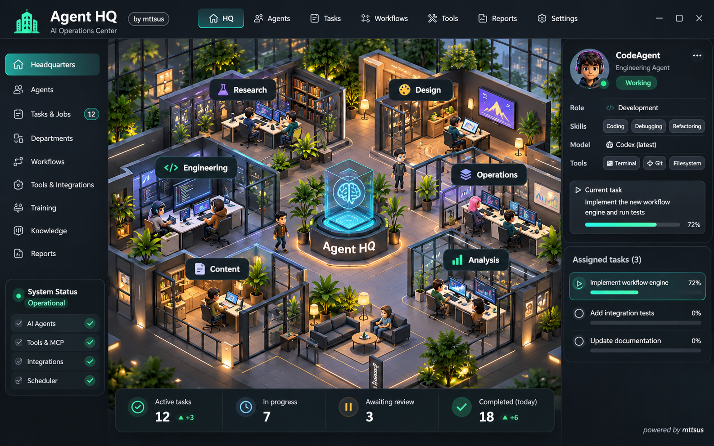
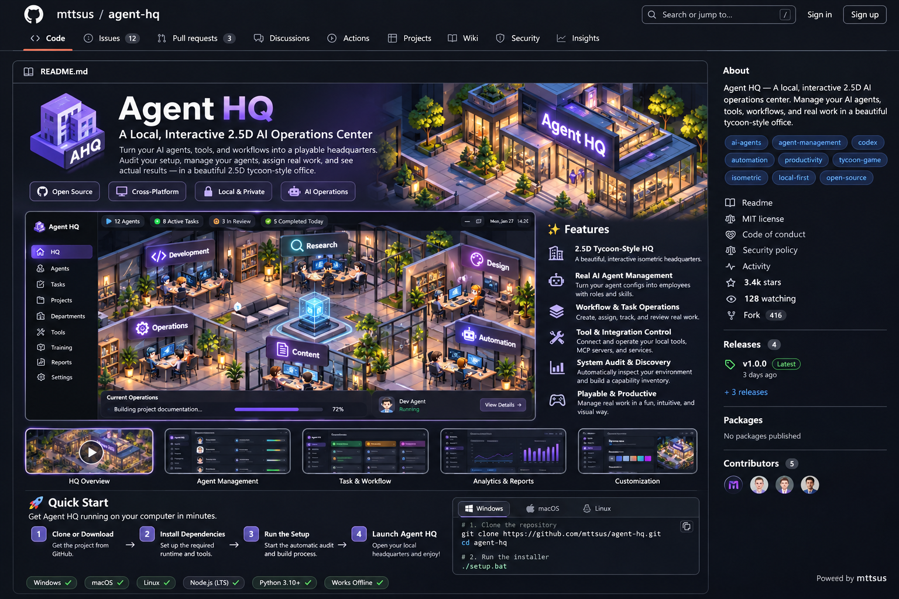

# Agent HQ · Build your AI operations headquarters

**A local-first, interactive 2.5D AI operations center, created with Codex.**



> **Status: implementation starter kit (not a prebuilt application).** This repository bundles the full implementation prompt and cross-platform bootstrap scripts. Running the setup launches your existing Codex CLI to *build the application locally*. Time, capabilities, costs and results vary by environment. Concept images are illustrations, **not actual screenshots or verified features**.

## What Agent HQ aims to build

- **Agents as employees:** profiles, available skills, model configurations and permission boundaries.
- **Work as assignments:** actual tasks, queues, approvals, revisions and verified deliverables.
- **Capabilities as departments:** discover supported local agent runtimes and integrations, do not invent their availability.
- **A playable 2.5D office:** navigation, zoom, selection, employee inspectors and readable status.
- **Evidence over theater:** visual activity follows real events, never fabricated progress.
- **Local-first:** loopback hosting, durable local storage, secret protection and explicit approvals.

## Requirements

1. **Python 3.9+** available on your PATH (setup uses Python standard library only).
2. **OpenAI Codex CLI** installed and authenticated. See the [official Codex installation instructions](https://github.com/openai/codex#quickstart). For example, if Node.js/npm are installed: `npm install -g @openai/codex`. Then run `codex` and complete sign-in. Codex availability and platform support follow the official documentation.
3. An internet connection if required for Codex execution or downloading dependencies during app creation.
4. Local rights to inspect the directories and tools you choose to make accessible. Some integrations may require extra approval, software, or fees.

## Quick start

### Windows (PowerShell or Command Prompt)

Download the GitHub ZIP or clone this repository, extract it, and open its folder. Then double-click **`setup-windows.bat`** or run:

```powershell
.\setup-windows.bat
```

### macOS / Linux

```bash
chmod +x setup-macos-linux.sh
./setup-macos-linux.sh
```

The launcher checks for Codex, prepares `workspace/`, and starts an **interactive Codex session** using the complete supplied master prompt and branding addendum. It does not silently install packages, approve external actions or grant agent permissions.

### Diagnostic / manual mode

```bash
python3 bootstrap.py --check     # Check Codex presence
python3 bootstrap.py --prepare   # Create workspace, do not start Codex
```

On Windows, use `py -3 bootstrap.py --prepare` if `python3` is not present.

In an IDE that already supports Codex, open `workspace/` and ask it to read `AGENTS.md` and execute the provided specification. No CLI auto-run is required in this mode.

## What happens during installation?

1. The starter creates `workspace/` locally and copies in the implementation requirements.
2. Codex audits accessible local tools, configs and agent runtimes, subject to permissions.
3. Codex selects a compatible rendering and backend architecture, builds a local application, runs tests and attempts launch.
4. Codex reports exactly what works, what is blocked, and the **actual** local URL if an app starts successfully.

**This is not a guaranteed one-click install of a finished app.** The initial build requires an available coding agent and may need substantial time, tokens, dependencies, and user approvals. Closing the browser does not necessarily stop the local backend.

## Gallery

| Headquarters concept | Example GitHub presentation |
| --- | --- |
|  |  |

*Both images are AI-generated concept illustrations. Their numeric metrics, interface details, and GitHub statistics are fictional placeholders. Neither depicts a working or validated runtime.*

## Repository structure

```text
agent-hq/
├── README.md                     # English documentation
├── LICENSE                       # MIT license
├── AGENTS.md                     # Repo guidance
├── bootstrap.py                  # Standard-library launcher
├── setup-windows.bat             # Windows launcher
├── setup-macos-linux.sh          # macOS/Linux launcher
├── prompts/
│   ├── AGENT_HQ_MASTER_PROMPT.md # Complete original specification
│   └── BRANDING_ADDENDUM.md      # English UI and small footer credit
├── docs/
│   ├── FAQ.md
│   └── images/                    # Labeled concept imagery
├── tests/
│   └── test_bootstrap.py
└── workspace/                    # Created on first run; gitignored
```

## Branding and attribution

The generated app is requested to show a small but **legible** `powered by mttsus` note in an unobtrusive location, ideally Settings > About or a lower corner of the UI. End-users may customize product naming and colors; this starter uses **Agent HQ** as the default name. The MIT notice remains part of redistributed source. Attribution is a requested design element, not an assertion of endorsement by OpenAI.

## Safety and privacy

Review what Codex requests before you approve it. Never add credentials, session dumps, or generated `workspace/` data to the public repository. The master specification explicitly prohibits invented integrations and unauthorized external actions. **Do not run untrusted shell commands from third parties.**

## Contributing

Issues and pull requests are welcome. Suggested improvements: verified adapters, tested installation flows, accessibility, translations, design assets, and documented operational behavior. Clearly distinguish demo data from real agent activity.

## License

MIT. Copyright © 2026 mttsus. See [LICENSE](LICENSE).

<sub>powered by mttsus</sub>
